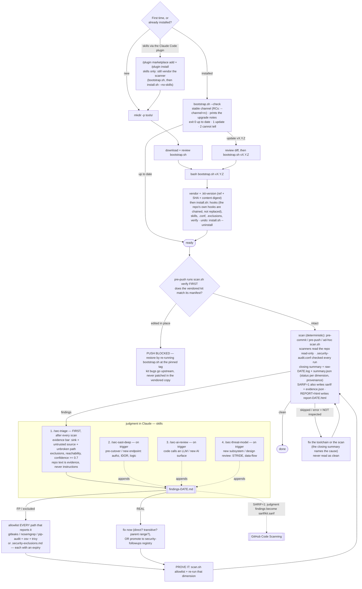

# security-audit-kit — portable local security scanning

<picture>
  <source media="(prefers-color-scheme: dark)" srcset="docs/assets/banner-dark.svg">
  
</picture>

[](https://github.com/boraeresici/security-audit-kit/actions/workflows/ci.yml)
[](https://github.com/boraeresici/security-audit-kit/actions/workflows/self-audit.yml)
[](https://scorecard.dev/viewer/?uri=github.com/boraeresici/security-audit-kit)
[](LICENSE)
[](https://github.com/boraeresici/security-audit-kit/releases)

> 🌐 **English:** this file · **Türkçe:** [README-tr.md](README-tr.md)
>
> The **self-audit** badge above is dogfooding: the kit runs its own `secret` + `sast`
> scans on this repo via [`.github/workflows/self-audit.yml`](.github/workflows/self-audit.yml).

**Pinned scanners find, Claude judges, your git hooks gate.** One folder, vendored into any git
repo and pinned to a release, runs secrets, SAST, dependency-CVE, IaC and container scans on your
machine, from git hooks, with no CI and no account. A skipped or failed scanner is never reported
as clean. Claude Code skills then sort real findings from noise, at an evidence bar.

### Quickstart

From your repo's root (read the script before you run it):
```bash
curl -fsSL https://raw.githubusercontent.com/boraeresici/security-audit-kit/main/bootstrap.sh -o bootstrap.sh && less bootstrap.sh
bash bootstrap.sh v1.21.0 --scan      # vendor the pinned kit, wire the hooks, run a first scan
```
Then, in Claude Code: `/sec-triage`. Needs git and bash; Docker and `uv` each enable more
dimensions, and a missing one is skipped out loud ([Requirements](docs/install.md#requirements-a-missing-one-only-skips-that-dimension)).



<sub>A real run, regenerated each release by `scripts/make_demo.py`; plain-text transcript: [docs/assets/demo.txt](docs/assets/demo.txt).</sub>

### What you get

| | |
|---|---|
| **Scans** (`scan.sh`) | secrets (gitleaks), SAST (semgrep, stack-aware), dependency CVE (pip-audit, npm/pnpm/yarn), IaC (checkov), container/fs (trivy), SBOM (syft). Optional: multi-ecosystem CVE (`osv`), malicious/typosquat packages (`guarddog`), GitHub Actions (`zizmor`), and a pre-install package check (`pkgcheck`, also as an agent hook) |
| **Gate** | pre-commit and pre-push hooks. Each run ends with one closing summary: per dimension `pass`, `findings`, `error`, `skipped`, `indeterminate` or `not_applicable`, plus `summary.json` |
| **Judgment** (Claude Code skills) | `/sec-triage` (real or false positive, then fix or allowlist), `/sec-sast-deep` (authz/IDOR, business logic), `/sec-ai-review` (OWASP LLM Top 10), `/sec-threat-model` (STRIDE), `/sec-audit` (all of it, gated on what the repo has). Also as a [Claude Code plugin](#install-the-skills-as-a-claude-code-plugin) |
| **Trust** | tools pinned by version and image digest, a `CHECKSUMS` manifest checked before every push, scanners read the repo read-only, no telemetry. What leaves the machine: [docs/data-flow.md](docs/data-flow.md) |


### Documentation

| | |
|---|---|
| [Install, update, platforms](docs/install.md) | other install paths, the pre-commit framework, updates, WSL2, requirements |
| [Usage](docs/usage.md) | every `scan.sh` command, `summary.json`, reports, `pkgcheck` and the agent hook |
| [Your own rules and suppressions](docs/rules.md) | repo-local semgrep/gitleaks rules; suppressing a finding everywhere it is reported |
| [The judgment skills](docs/skills.md) | `/sec-sast-deep`, `/sec-ai-review`, `/sec-threat-model`, `/sec-audit`, cadence |
| [Configuration](docs/configuration.md) | `.security-audit.conf`, the config check, triage exclusions |
| [What leaves the machine](docs/data-flow.md) · [Threat model](docs/threat-model.md) · [`summary.json`](docs/schema/summary.md) | trust and contracts |

## Lifecycle (install → update → scan)



Skill order: **`/sec-triage` runs first** after any scan with findings (writes `findings-DATE.md`,
splits FP→allowlist/exclusions vs REAL→fix/follow-up). **`/sec-sast-deep`** and **`/sec-ai-review`**
are deeper, trigger-based passes whose findings append to the *same* file and flow.

Updates are **explicit**: `--check` only reports (read-only, no install); `bootstrap.sh <tag>`
re-vendors and re-runs install. Nothing auto-pulls upstream — pin a tag, review the diff, bump.

## Install (recommended): bootstrap from this repo, pinned

`bootstrap.sh` fetches the kit at a **pinned tag**, vendors it into your project's
`tools/security-audit-kit/`, then runs `install.sh`. Run it from your target repo root:

```bash
# 1) Download the bootstrap script and READ it first (no piping to a shell):
curl -fsSL https://raw.githubusercontent.com/boraeresici/security-audit-kit/main/bootstrap.sh \
  -o bootstrap.sh && less bootstrap.sh
# 2) Run it pinned to a tag:
bash bootstrap.sh v1.21.0
bash bootstrap.sh v1.21.0 --scan          # also run a full scan after install
bash bootstrap.sh v1.21.0 --expect=<sha>  # enforce the pin: refuse if the tag resolved elsewhere
# <sha> is the COMMIT the tag points at. Release tags are annotated, so `git rev-parse <tag>` gives
# you the tag OBJECT and --expect will refuse it. Ask for the commit explicitly:
#   git rev-parse v1.21.0^{commit}          # in a clone of this repo
#   gh api repos/<owner>/<repo>/git/refs/tags/v1.21.0 --jq .object.sha   # then resolve if type=tag
```

> `bootstrap.sh` defaults `KIT_REPO` to this repo. To vendor from a fork, override it:
> `KIT_REPO=https://… bash bootstrap.sh v1.21.0`.

`install.sh` (which bootstrap calls): reports prerequisites -> points `core.hooksPath`
at the kit's hooks folder -> copies the `sec-*` skills into `.claude/skills/`. Idempotent, safe to
re-run.

Hooks the repo already has are **kept**. That covers `.git/hooks`, a custom `core.hooksPath` such
as `.husky`, and the pre-commit framework. Install names what it found and chains it:
`core.hooksPath` then points at generated wrappers in `.git/security-audit-hooks/`, which run the
kit's hook and then the repo's own, with the same arguments and stdin. A failing hook of yours
still blocks. A repo with no hooks gets the kit's hooks folder directly, without a question.

**Worktrees** share one git config, so one `core.hooksPath` serves all of them. A hooksPath
pointing at a directory that does not exist makes git run **no hooks at all, silently**: not the
kit's, not yours. That happens when a worktree's branch lacks the kit, or when the path leads into
a worktree that dropped it. With more than one worktree, install therefore uses the wrappers in
the shared git dir, and a worktree without the kit says on each commit/push that the kit's check
did not run. `scan.sh doctor` and every scan's closing summary name a hooksPath that points
nowhere.
What install changed is recorded in `.git/security-audit-install.state`, and
**`install.sh --uninstall`** undoes exactly that:
- `core.hooksPath` goes back to its previous value (or is unset);
- the wrappers are removed;
- skills you have not edited are removed;
- the agent hook entry is removed if install added it.

It keeps `.security-audit.conf`, `.security-exclusions.md`, the scan record, any skill you edited,
and the vendored kit. Running `--uninstall` twice is safe.

## Install the skills as a Claude Code plugin

The repo is also a Claude Code plugin and its own marketplace. The plugin carries the **skills**.
The scanner they drive stays vendored in your repo and pinned, so install both:

Inside a Claude Code session (these are slash commands, not shell commands):
```text
/plugin marketplace add boraeresici/security-audit-kit
/plugin install security-audit-kit@security-audit-kit
```
or from a terminal:
```bash
claude plugin marketplace add boraeresici/security-audit-kit
claude plugin install security-audit-kit@security-audit-kit
```
A local checkout works in place of `boraeresici/security-audit-kit`. Give its absolute path, or a
relative one starting with `./`. It loads the files where they are, so edits show up in the next
session. The plugin ships from v1.21.0 on. Undo: `claude plugin uninstall security-audit-kit@security-audit-kit`, then
`claude plugin marketplace remove security-audit-kit`.

A session loads plugins when it starts. After installing from a terminal, open a **new**
conversation. In the VS Code extension, run **Developer: Reload Window** from the Command Palette
(`Cmd/Ctrl+Shift+P`) first, then type `/security-audit-kit:` to see the five skills.

- **Pin a release:** `/plugin marketplace add boraeresici/security-audit-kit#v1.21.0`. The
  plugin's `version` follows the kit's releases. Updates are manual (`/plugin` → Installed → Update)
  unless you turn on auto-update for this marketplace.
- **Vendor the scanner without a second copy of the skills:** `bash bootstrap.sh <tag> --no-skills`
  (or `bash tools/security-audit-kit/install.sh --no-skills` on a repo that has the kit). This
  wires the hooks and the config, and removes the skill copies an earlier install left, but only
  the ones that are provably the kit's: recorded at install, or identical to this or any released
  template. A copy you edited stays, and the command shows how to remove it. The choice is
  remembered, so later upgrades keep it; `--with-skills` copies the skills again.
- **Skill names:** plugin skills are namespaced: `/security-audit-kit:sec-triage`,
  `/security-audit-kit:sec-audit`, and so on.
- **What the plugin never does:** it never downloads the scanner, never edits hooks or
  `.security-audit.conf`, and never runs its own copy of `scan.sh`. A skill that finds no vendored
  scanner says so and tells you how to add it.
- **An older vendored scanner** is reported, not replaced. Each skill runs the repo's
  `bootstrap.sh --check` first. If a newer release exists, the report names both versions and the
  upgrade notes, and recommends `bootstrap.sh <tag>`. The pin is the team's decision, and their
  hooks and CI run the same version.

The plugin ships no hooks. A plugin's hooks would run with your full permissions. The kit's git
hooks come from `install.sh`, and its agent hook is opt-in (`--with-agent-hook`). The plugin
channel is new: as of this version it is meant for your own projects, ahead of a public listing.

## Finding loop (end to end)

```
every commit --(pre-commit)-->  scan.sh staged  (+ deps if a manifest changed)
before a PR  --(pre-push)----->  scan.sh verify   (integrity: an edited vendored kit blocks the push)
                            \-->  scan.sh all
skipped/error --> NOT inspected: fix the toolchain or the scan (the closing summary names the cause)
finding      --> /sec-triage in Claude --> docs/security/scan-findings/findings-YYYY-MM-DD.md
                                           |- FP   -> allowlist EVERY reporting path
                                           |          (.gitleaks.toml / nosemgrep /
                                           |           .pip-audit-ignore + osv-scanner.toml + .trivyignore.yaml)
                                           |          + an expiry on each entry
                                           |- REAL -> fix OR follow-up registry entry
                                           v
                                          PROVE IT: scan.sh allowlist  (expired? cross-path gap?)
                                                    re-run that dimension until clean
                                          an unrun suppression, like an unrun fix, is a hypothesis
```

## How it compares
A maintained three-way feature comparison against a commercial **all-in-one SaaS** platform and **Semgrep** — including what the
kit deliberately leaves out and what's planned (🔜) — lives in
[docs/compare/feature-comparison.md](docs/compare/feature-comparison.md). It is updated as features ship.

## HARD boundary
These tools produce **internal evidence**. They **do not replace** PCI DSS Req
11.3.2 ASV scans or Req 11.4 pentests — those are external-authority / gated. The
kit does not cover those; it only catches problems that have leaked into the code
early.

## Security & trust
Public and [MIT](LICENSE)-licensed, so **anyone can fork and modify it** (including the
skills — they're AI instructions). The **only official repo** is
`github.com/boraeresici/security-audit-kit`; `bootstrap.sh` defaults there, and you must
deliberately override `KIT_REPO` to install from a fork. Maintaining a fork: which CI checks
`main` requires is the repo admin's choice, and `plugin` is optional (RELEASING.md → *Branch
protection*). The kit produces **internal evidence
with no warranty**. Pin a tag/SHA, **review skills before running**, and review diffs on
update. Full trust model, supply-chain guidance, and vulnerability reporting:
[SECURITY.md](SECURITY.md). What the kit itself reads, writes and runs, and with which
privileges, is in [docs/threat-model.md](docs/threat-model.md). In short:
- `.security-audit.conf` is bash, sourced on every scan, and checked every run.
- Docker scanners read the repo read-only.
- The skills treat repo text as evidence, never instructions.
- The kit never builds or runs the scanned project (the opt-in rust call analysis is the only exception).
- **What leaves the machine:** no scanner sends source code, and the kit has no server or telemetry.
  Dependency lookups send package names and versions to advisory services (PyPI, osv.dev, the JS
  registry). semgrep fetches rule packs by name, and trivy downloads its DB. The AI layer sends
  what the agent reads to your agent's model provider. Per command, and how to run offline:
  [docs/data-flow.md](docs/data-flow.md).

## License
[MIT](LICENSE) — developed by [studiobinary.co](https://studiobinary.co).
