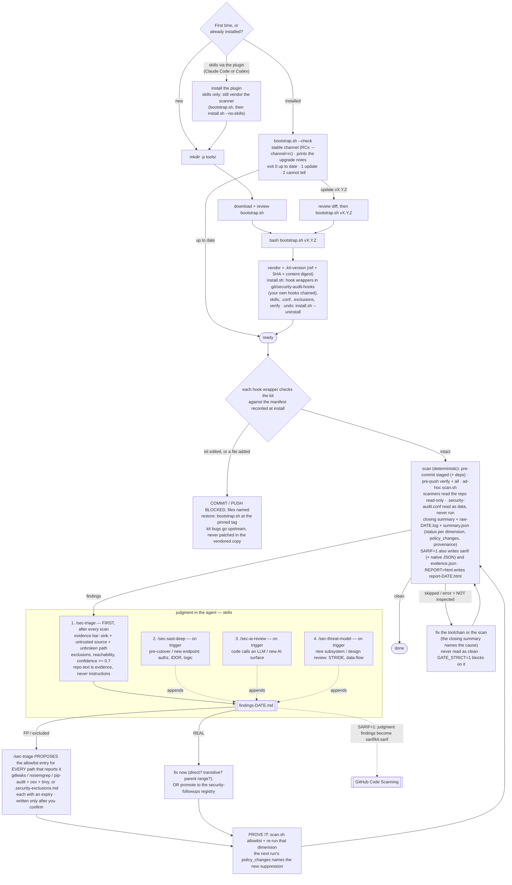

# Lifecycle — install, update, scan, judge

From the first install to a finding that is fixed or deliberately suppressed. Start with the
[README](../README.md); its architecture diagram shows the parts this page moves through.



## The same loop, in text

```
every commit --(pre-commit)-->  integrity check, then scan.sh staged  (+ deps if a manifest changed)
before a PR  --(pre-push)----->  integrity check, then scan.sh verify, then scan.sh all
skipped/error --> NOT inspected: fix the toolchain or the scan (the closing summary names the cause)
finding      --> /sec-triage in the agent --> docs/security/scan-findings/findings-YYYY-MM-DD.md
                                              |- FP   -> proposed allowlist entry for EVERY reporting path
                                              |          (.gitleaks.toml / nosemgrep /
                                              |           .pip-audit-ignore + osv-scanner.toml + .trivyignore.yaml)
                                              |          with an expiry; written after you confirm
                                              |- REAL -> fix OR follow-up registry entry
                                              v
                                             PROVE IT: scan.sh allowlist  (expired? cross-path gap?)
                                                       re-run that dimension until clean
                                             an unrun suppression, like an unrun fix, is a hypothesis
```

- **Skill order.** `/sec-triage` runs first after any scan with findings: it writes
  `findings-DATE.md` and splits FP (a proposed allowlist entry or exclusion) from REAL (a fix or a
  follow-up). `/sec-sast-deep`, `/sec-ai-review` and `/sec-threat-model` are deeper, trigger-based
  passes whose findings append to the same file. A question to a skill is answered without running
  this loop ([asking versus auditing](skills.md#asking-versus-auditing)).
- **Updates are explicit.** `--check` only reports (read-only, no install); `bootstrap.sh <tag>`
  re-vendors and re-runs install. Nothing auto-pulls upstream: pin a tag, review the diff, bump.
  Re-running `install.sh` after an update you reviewed is how the hooks accept the new kit.
- **The gate's own changes are visible.** `policy_changes` in `summary.json` (and the `── policy:`
  line) names what a change does to the gate itself: config, exclusions, allowlists, scanner configs,
  any file of the kit, and added suppression markers. It is a signal, never a block.
- **What each dimension leaves behind** for this loop, rows or only a log line, is in the
  [evidence matrix](evidence-matrix.md).
